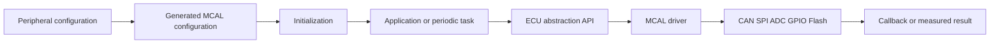

# AURIX MCAL 주변장치 실습

[MCAL_Training/](MCAL_Training/)의 각 폴더는 TC234LP용 독립 IDE 프로젝트입니다. 제공 MCAL을 설정하고 응용 코드에서 CAN·SPI·ADC·타이머·비휘발성 저장 기능을 연결하는 실습으로 구성됩니다.

| 폴더 | 내용 |
| --- | --- |
| BaseProject, HelloWorld, ProcessingSpeed | 기본 프로젝트, 출력·실행 속도 실습 |
| GPT, ADC, DIO | 타이머와 입출력 |
| CAN_1, CAN_2, CAN_3 | CAN 실습 단계 |
| SPI_1, SPI_2 | SPI 센서 연동 |
| FEE, FEE_GC | Flash EEPROM Emulation과 가비지 컬렉션 |
| WDG, XCP | Watchdog·계측 |
| Complete | 통합 실습 구성 |

각 폴더의 `.project`를 AURIX Development Studio로 가져옵니다. [외부 의존성](EXTERNAL_DEPENDENCIES.md)에 기록된 MCAL 패키지를 준비하고, EB tresos 설정 및 TC23x 링커 파일을 확인한 후 프로젝트별로 빌드합니다. 보드 연결과 디버깅에는 해당 교육용 ECU와 Trace32 환경이 필요합니다.

## English

### AURIX MCAL Peripheral Labs

Each directory in [MCAL_Training/](MCAL_Training/) is an independent TC234LP IDE project. Import the selected project into AURIX Development Studio, restore its [licensed dependencies](EXTERNAL_DEPENDENCIES.md), and verify EB tresos configuration and linker settings before building.

The folders preserve the course exercise stages, including CAN, SPI, FEE garbage collection, watchdog and XCP.
