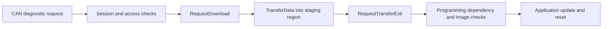

# CAN/UDS ECU 부트로더

[SCU_Gen6/](SCU_Gen6/)는 TC234LP 기반 ECU의 리프로그래밍 프로젝트입니다. CAN 진단 요청을 처리하고, 전송된 바이너리를 Flash에 기록하며 SHA-256을 사용한 이미지 확인 흐름을 제공합니다.

## 구조와 실행

- `Source/2_App/BswDcm/Rte_BswDcm.c` · 세션, SecurityAccess, 다운로드·전송·종료 요청 처리
- `Source/3_EcuAbs/` · CAN, Flash·비휘발성 메모리, 주변장치 추상화
- `Source/1_Common/KISA_SHA256.*` · 이미지 해시 계산
- `Source/5_Bsw/` · BSW 설정과 외부 드라이버 연결
- `SCU_Gen6_Training.lsl` · 메모리 배치
- `Training/PostProcess.bat` · Hexview를 사용한 부트·앱 이미지 후처리

AURIX Development Studio에서 `SCU_Gen6`를 기존 프로젝트로 가져옵니다. TC23x용 빌드 환경과 [외부 의존성](EXTERNAL_DEPENDENCIES.md)을 준비하고, 보드 메모리 배치에 맞춰 링커 설정을 확인한 후 빌드합니다. 후처리에는 별도 Hexview 설치가 필요합니다. `PostProcess.bat`의 입력 이미지와 주소를 확인한 뒤 실행합니다.

## English

### CAN/UDS ECU Bootloader

[SCU_Gen6/](SCU_Gen6/) contains the TC234LP ECU project, diagnostic application, ECU abstraction, configuration and linker scripts. Import it into AURIX Development Studio and restore the licensed [external dependencies](EXTERNAL_DEPENDENCIES.md). Binary post-processing requires Hexview and the expected application image.

The source includes educational diagnostic and image-integrity mechanisms. The transfer, validation and memory layout are implemented in the diagnostic application and ECU abstraction layers.
