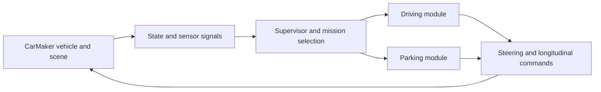

# CarMaker 자율주행·주차 시스템

[autonomous-driving-missions/](autonomous-driving-missions/)는 팀의 주행·주차 개발 프로젝트입니다. Python 알고리즘 실습과 CarMaker/Simulink 모델, 시나리오·차량 설정을 포함합니다.

## 구성

- `01_Python_project/` · 필터, PID, 차량 제어·경로계획 실습
- `02_Carmaker_project/Practice_sample/Data/` · CarMaker 프로젝트 데이터
- `02_Carmaker_project/Practice_sample/src_cm4sl/Models/` · 단계별 Simulink 모델
- `Models/FinalProject/Final_Project.slx` · 통합 모델
- `Models/FinalProject/Modules/Parking/Parking.slx` · 주차 모듈

## 실행 환경

CarMaker 14.1.2와 호환 MATLAB/Simulink, CarMaker for Simulink 라이선스가 필요합니다. `Practice_sample`을 CarMaker 프로젝트로 열고 `src_cm4sl/cmenv.m`의 설치 경로를 로컬 환경에 맞춥니다. MATLAB에서 해당 폴더를 현재 폴더로 설정한 뒤 `cmenv`를 실행하고 원하는 모델을 엽니다. 로컬 CarMaker 설치의 프로젝트 갱신·빌드 절차로 S-function과 실행 파일을 준비합니다.

Python 실습 환경은 `pyproject.toml`과 `uv.lock`에 정의되어 있습니다. 프로젝트 루트에서 `uv sync`를 실행한 뒤 각 실습 폴더의 스크립트를 사용합니다. 원본 설정의 Python 요구 버전은 3.14입니다.

주차 모듈 개발 중 기어 명령의 주기 충돌을 분석했습니다. 주행·슈퍼바이저와 주차의 최종 통합은 완료하지 못했습니다.

## English

### CarMaker Driving and Parking System

[autonomous-driving-missions/](autonomous-driving-missions/) contains the team project with Python exercises, CarMaker data and Simulink models.

Use CarMaker 14.1.2 with a compatible MATLAB/Simulink and CarMaker for Simulink license. Open `Practice_sample` in CarMaker, set the installation path in `src_cm4sl/cmenv.m`, then run `cmenv` from that folder in MATLAB. Open a model under `Models/` and build the simulation components using the local CarMaker installation. The Python exercises use Python 3.14 and dependencies from `uv sync`.

The project includes subsystem development and gear-command timing investigations. Final integration of parking with driving and the supervisor remained incomplete.
