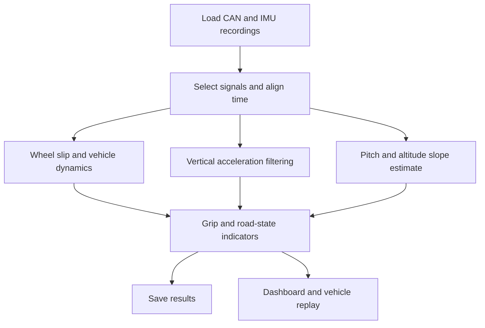

# 노면 상태 추정

[adas_project/](adas_project/)는 휠 속도와 IMU 기록으로 슬립·진동·경사·접지 상태를 계산하고 MATLAB 대시보드로 재생하는 프로젝트입니다.

## 실행

MATLAB의 현재 폴더를 `adas_project/final`로 이동하고 `final_v2`를 실행합니다. 입력은 같은 폴더의 `testset1.mat` 또는 `testset3.mat`이며, 데이터 선택 UI로 전환할 수 있습니다. 결과는 데이터셋 이름을 포함하는 `road_surface_final_project_result_*.mat`에 저장됩니다. 필터 처리를 위해 Signal Processing Toolbox를 사용합니다.

`project_1/`에는 이전 단계의 추정·시각화 스크립트가 있고, `draw_veh.m`은 차량 표시 함수입니다. 차량 파라미터와 임계값은 각 스크립트 상단에서 설정합니다. 기록 데이터의 추정 결과는 실제 노면 정답과 비교해 평가할 수 있습니다.

## English

### Road Condition Estimation

[adas_project/](adas_project/) processes recorded wheel-speed and inertial signals and replays the resulting indicators in MATLAB.

Set the working directory to `adas_project/final` and run `final_v2`. The dashboard selects `testset1.mat` or `testset3.mat`. Results are saved as `road_surface_final_project_result_*.mat`. Signal Processing Toolbox supports the filtering stage. Vehicle parameters and thresholds are defined near the top of the script.

Earlier estimator and visualization stages are kept in `project_1/`.
