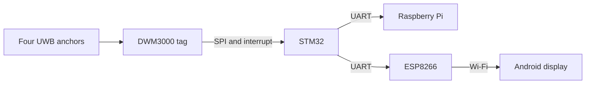

# UWB 현장 위치측정

산학협력 농기계 캡스톤에서 UWB 위치측정 펌웨어를 담당했습니다. STM32와 DWM3000을 SPI로 연결하고, 제조사 DS-TWR 예제를 다중 앵커용으로 확장했습니다. 계산한 위치를 UART로 Raspberry Pi에 보내고 ESP8266을 통해 안드로이드 앱에서도 확인했습니다.

정지한 태그에서는 좌표가 최대 약 5 cm 흔들렸고, 약 50 × 50 m 현장 시험에서는 앵커 배치와 안테나 방향에 따른 통신 안정성을 관찰했습니다. 5 cm는 정지 시 변동 폭이며, 넓은 구역의 절대 위치 오차를 측정한 값은 아닙니다.

## 위치 계산 코드 실행

[src/](src/)에는 원본 펌웨어의 3개 이상 앵커 위치 계산 루틴을 분리한 C 코드가 있습니다. 예제는 가상의 거리 4개를 생성해 (12, 18) m를 추정합니다. 이 코드는 C 표준 라이브러리만 사용합니다.

```sh
gcc -std=c11 -Wall -Wextra src/demo.c src/uwb_position.c -lm -o uwb-demo
./uwb-demo
```

---

## English

## UWB Localization for Agricultural Machinery

In an industry-sponsored capstone, I was responsible for embedded software for UWB localization. The goal was to provide position data for a prototype agricultural machine.

### System and contribution



I extended a vendor reference implementation of double-sided two-way ranging to a multi-anchor system, worked on tag-side position estimation, and integrated live position output to a Raspberry Pi and an Android prototype.

### Field observations

The summer project report documents position updates within a roughly 50 × 50 m test area. Communication became less stable beyond that area depending on antenna orientation. With the tag stationary, the reported position fluctuated by up to roughly 5 cm in the observed test. That figure describes stationary variation. Absolute position error across the full field still needed a reference measurement.

I documented hardware connections and setup variants for the next person bringing up the system.

### Run the position estimator

[src/](src/) adapts the original estimator for three or more anchor readings into a standalone C module. The demo generates four synthetic distances and estimates a tag at (12, 18) m.

```sh
gcc -std=c11 -Wall -Wextra src/demo.c src/uwb_position.c -lm -o uwb-demo
./uwb-demo
```
