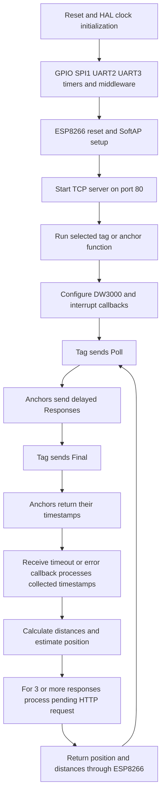
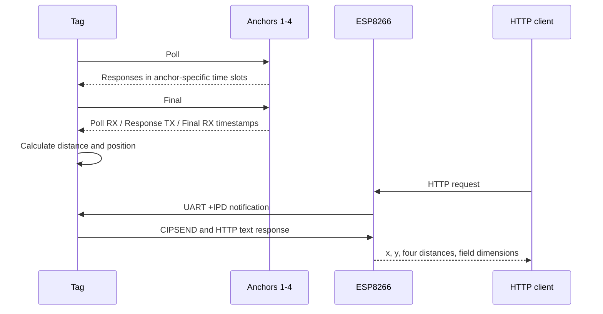

# UWB 4:1 위치측정 · ESP8266 웹 출력

[UWB_4_1_esp8266_3/](UWB_4_1_esp8266_3/)는 STM32CubeIDE에서 가져와 빌드할 수 있도록 원본 디렉터리 구조를 보존한 펌웨어 프로젝트입니다. STM32F429ZI와 DWM3000을 사용하는 태그 1대가 앵커 최대 4대와 거리를 측정하고, 계산한 좌표를 ESP8266의 HTTP 응답으로 제공합니다.

## 시스템 구성

- STM32F429ZI ↔ DWM3000 · SPI1과 외부 인터럽트
- STM32 ↔ ESP8266 · USART2
- STM32 ↔ PC 터미널 · USART3
- ESP8266 · SoftAP 모드, TCP 포트 80의 HTTP 응답
- 태그 · initiator, 앵커 · responder. 같은 프로젝트에서 역할을 선택해 각각 빌드합니다.

## 폴더와 진입점

| 경로 | 역할 |
| --- | --- |
| `Core/Src/main.c` | HAL·클럭·주변장치 초기화, ESP 초기화, 선택된 UWB 함수 실행 |
| `custom_code/ds_twr_initiator_irq.c` | 태그 상태 처리, 타임스탬프 수집, 거리·위치 계산 |
| `custom_code/ds_twr_responder_irq.c` | 앵커별 지연 응답과 타임스탬프 반환 |
| `Core/Src/ESP8266_HAL.c` | AT 명령, SoftAP·서버 설정, 좌표 HTTP 응답 |
| `Core/Src/UartRingbuffer_multi.c` | UART 수신 버퍼 |
| `Src/example_selection.h` | 태그·앵커 역할 선택 |
| `platform/`, `Shared/`, `Drivers/` | 보드 연동, Qorvo UWB 드라이버, STM32 HAL·CMSIS |
| `LWIP/`, `Middlewares/`, `USB_DEVICE/` | 원본 프로젝트에 포함된 통신 미들웨어 |
| `.project`, `.cproject`, `*.ioc`, `*.ld` | IDE 프로젝트, 핀·클럭 설정, 링커 스크립트 |

## 동작 흐름

태그가 Poll을 보내면 앵커들은 지정된 지연 시간에 Response를 보냅니다. 태그의 Final을 받은 앵커들은 자체 송수신 타임스탬프를 추가 메시지로 돌려줍니다. 태그는 수집한 양측 타임스탬프로 거리를 구하고, 응답 종료·타임아웃·오류 콜백에서 수집 결과를 처리한 뒤 다음 측정으로 진행합니다.

위치 함수는 응답 2개일 때 축 정렬 앵커에 대한 계산 분기, 3개 이상일 때 반복 최적화 분기를 갖습니다. 3개 이상 분기에서 `Server_Start()`를 호출해 대기 중인 HTTP 요청에 좌표와 앵커별 거리를 응답합니다. 이 버전은 인터럽트 콜백 경로에서 위치 계산과 서버 처리를 수행합니다.

## 가져오기와 실행

1. STM32CubeIDE에서 **File → Import → General → Existing Projects into Workspace**를 열고 `UWB_4_1_esp8266_3`를 선택합니다.
2. `Src/example_selection.h`에서 태그는 `TEST_DS_TWR_INITIATOR_irq`, 앵커는 `TEST_DS_TWR_RESPONDER_irq` 하나만 활성화합니다. 현재 원본은 태그로 설정되어 있습니다.
3. 앵커별로 responder 파일의 `ANCHOR`를 1~4로 지정해 빌드·플래시합니다. 원본 설정값은 4입니다.
4. 태그 파일의 `pos_anchors`를 실제 설치 좌표에 맞춥니다. 원본은 50 × 50 m 사각형입니다. 배선은 `.ioc`와 `Core/Inc/main.h`의 핀 정의를 확인합니다.
5. `ESP8266_HAL.c`의 `AT+CWSAP`에 있는 실습용 SSID·암호를 설정하고, UART 통신 속도를 ESP8266 펌웨어와 맞춥니다.
6. 빌드 후 ST-LINK로 플래시합니다. USART3 로그의 AP IP 주소를 확인하고 SoftAP에 연결한 기기에서 해당 주소로 HTTP 요청을 보냅니다.

HTTP 본문에는 `x`, `y`, `dist1`~`dist4`와 설치 구역 크기가 텍스트로 들어갑니다. ESP 초기화는 OK 응답을 기다리는 루프를 사용하므로 모듈 연결이나 통신 속도가 맞지 않으면 초기화가 진행되지 않을 수 있습니다.

## 원본과 확인 범위

원본 소스·드라이버·IDE 설정을 함께 보관했습니다. 재생성되는 `Debug/` 빌드 결과와 개인 디버그 실행 설정 `*.launch`는 제외했습니다. Qorvo 및 ST 등의 저작권·라이선스 고지는 각 원본 폴더에 있습니다.

[src/](src/)는 별도로 정리한 PC 실행용 위치 계산 예제입니다.

---

## English

### System

[UWB_4_1_esp8266_3/](UWB_4_1_esp8266_3/) preserves the original STM32CubeIDE firmware project, including application code, vendor drivers, middleware, linker scripts and IDE configuration. One STM32F429ZI/DWM3000 tag ranges against up to four anchors and exposes coordinates through an ESP8266 HTTP server.

### Runtime flow

### Import and configure

1. Import `UWB_4_1_esp8266_3` as an existing project in STM32CubeIDE.
2. Enable exactly one role in `Src/example_selection.h`. The archive selects `TEST_DS_TWR_INITIATOR_irq`. Use `TEST_DS_TWR_RESPONDER_irq` for anchors.
3. Set `ANCHOR` to 1–4 in the responder for each anchor. Configure `pos_anchors` in the initiator to match the actual installation.
4. Review the pin mapping in the `.ioc` and `Core/Inc/main.h`. SPI1 connects the radio, USART2 connects ESP8266, and USART3 provides terminal logs.
5. Configure the lab access-point credentials in `ESP8266_HAL.c`, build and flash with ST-LINK. Connect to the SoftAP and request the IP address printed in the terminal.

The two-response position branch assumes axis-aligned anchor geometry. The three-or-more-response branch performs iterative optimization and handles pending HTTP requests. Position calculation and HTTP handling run on the interrupt callback path in this version. ESP initialization waits for AT responses and can block if the module is unavailable.

### Files and verification

The `custom_code/` directory holds tag and anchor logic. `Core/` provides initialization, UART buffering and the ESP8266 interface. `Shared/`, `Drivers/` and `platform/` supply the radio and MCU integration. Original vendor notices remain with their files.

Generated `Debug/` output and personal `*.launch` settings are omitted. The separate [src/](src/) directory contains the desktop estimator example.
